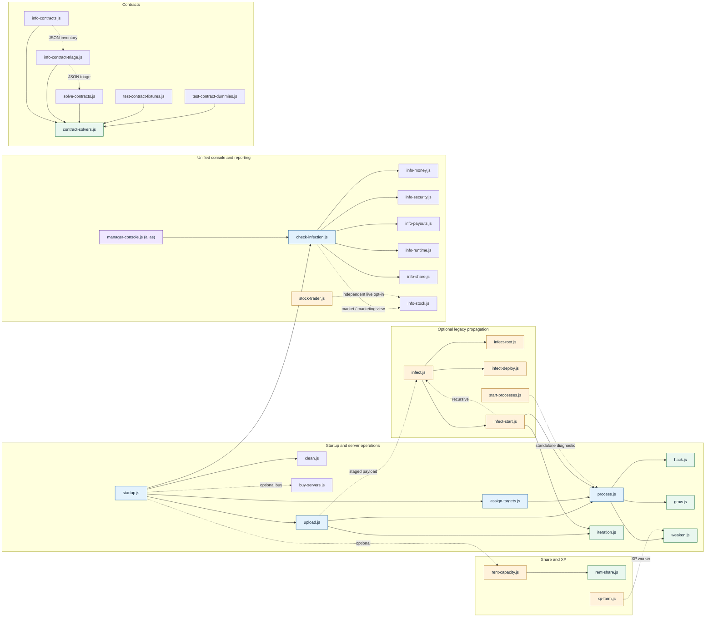

# Script dependencies (GitHub Mermaid)

The diagram distinguishes the standard runtime graph, optional execution,
pure library imports, and compatibility aliases. Reporting files are not
launched by the ordinary hacking worker pipeline.

### Other standalone scripts

- `info-diagnostic.js`, `info-startup-config.js`, `info-player.js`,
  `session-gains.js`, `backdoor-check.js`, `faction-control.js`,
  `info-infiltration.js`, `info-progression-gaps.js`, `logview.js`.
- `help-market.js`, `help-contracts.js`, `help-network.js`,
  `help-servers.js`, `help-share.js`, `help-diagnostics.js`,
  `help-progression.js`, `help-darknet.js`. Alias:
  `contract-help.js` → `help-contracts.js`.

In the graph, solid arrows normally represent execution, imports or deployed
dependencies; dotted arrows show optional paths, modes or document/report-only
relationships. `clean.js` and `info-diagnostic.js` refer to other scripts
by name for cleanup/observation without launching them.

For all audited references, classifications and safe cleanup candidates, see
[LEGACY_SCRIPT_AUDIT.md](LEGACY_SCRIPT_AUDIT.md).
